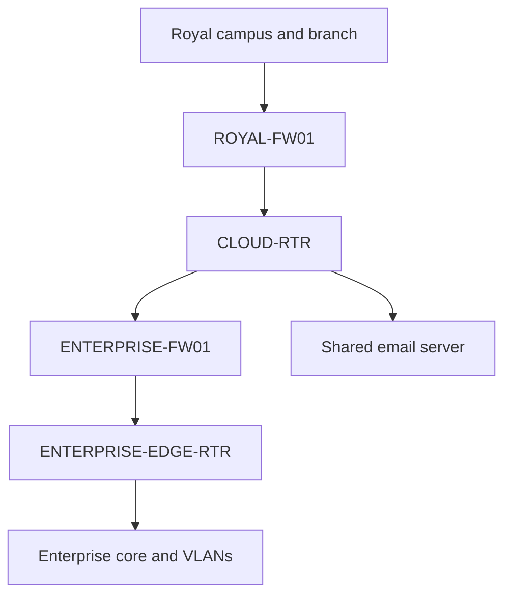

# Royal Technology Solutions | Network Design & Integration Portfolio

**LaVon Thomas · Cisco Packet Tracer · Completed October 29, 2026**

Two independently completed network designs became one integrated campus, branch, and Enterprise lab. This portfolio shows the original design scopes and the integration work that made cross-site web access, email, and calling work through site firewalls.

## Three designs, one engineering story

| Stage | Design | Focus | Documentation |
|---|---|---|---|
| 1 | Royal campus and branch | Department segmentation, router-on-a-stick, DHCP, branch routing, voice | [Campus and branch](designs/01-campus-branch/README.md) |
| 2 | Enterprise campus | Four-floor topology, OSPF core, /26 VLANs, HSRP gateways, services and voice | [Enterprise](designs/02-enterprise/README.md) |
| 3 | Integrated Intersite-Lab | Combine both networks; add Enterprise firewall and edge router; validate cross-site services | [Integrated design](designs/03-integrated/README.md) |

The existing repository contains an earlier campus/branch README, topology evidence, and a `.pkt` file. The two completed standalone versions and final integrated `.pkt` still need owner confirmation before attachment. The integrated screenshot above is the actual final topology provided by the project owner; standalone designs are described from the project record rather than presented as newly verified file exports.

## What I implemented

- Connected Royal campus/branch and Enterprise networks through a simulated provider/cloud router.
- Preserved the existing Enterprise floor uplinks while adding an ASA 5506-X firewall and a Cisco 2911 edge router.
- Configured /30 transit networks, static routes, OSPF redistribution, and a passive OSPF transit interface.
- Used departmental data and voice VLANs, HSRP virtual gateways, DHCP/DNS services, and Cisco call-manager dial peers.
- Configured service-specific firewall permissions for ICMP, DNS, HTTPS, and H.323 signaling.
- Consolidated simulated mail to a shared server and validated intersite message delivery and replies.

## Integrated perimeter

The old direct CLOUD-RTR–core serial connection remains administratively shut down. The active path crosses the Enterprise firewall. Re-enabling the old link would create a preferred bypass because its retained static routes have a lower administrative distance.

## Results

| Capability | Evidence |
|---|---|
| Cross-site IP reachability | Captured successful endpoint pings; owner confirmed all-PC reachability at completion |
| HTTPS in each direction | Campus accessed 192.168.12.198; Enterprise accessed 192.168.8.18 |
| Email | Cross-site send, receive, and reply confirmed |
| Voice | Successful cross-site call; final owner confirmation of calling service |
| Routing | Captured route tables showed the new firewall/edge path selected |

## Problems I investigated

Address overlap required renumbering the branch student subnet to 192.168.210.0/24. Copied sticky MAC entries required targeted port-security recovery. The new edge transit network needed an internal OSPF advertisement for return reachability. Simulation-mode packet inspection identified HTTPS drops at the ASAs. Explicit, narrowly scoped source-port-443 reply rules restored the tested web sessions. A later outside-link reset restored next-hop ARP learning before final end-to-end success.

I documented observations separately from root-cause conclusions: the intermittent serial and forwarding failures were not conclusively attributed to a specific cause.

## Technical record and scope

See the [architecture, addressing, routing, ACLs, and recovery record](docs/architecture-and-operational-record.md).

This is a Packet Tracer lab portfolio. The cloud segment is simulated routing, not AWS or an IPsec VPN. Teams/Microsoft 365 were an analogy for intersite collaboration, not deployed applications. The separate Royalty.Local and Royal1.Local Windows labs are not connected to this simulation. The recorded HTTPS reply rules cover the two tested clients, not every PC. Final functional completion is owner-confirmed; long-duration availability and failover testing are not claimed.

**Repository preparation:** See [publishing notes](publishing/PUBLISHING.md) for the remaining source files and release steps.
