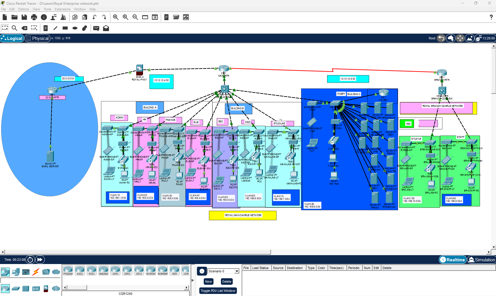

# Design 1 — Royal Campus and Branch

**Role in portfolio:** The first standalone design, later incorporated into the integrated lab.

Original owner-provided screenshot of `Royal Enterprise network.pkt`, showing the Royal main campus, branch, server segment, cloud mail segment, and ROYAL-FW01. The branch student subnet is shown as 192.168.10.0/24 before its integration renumbering.

## Design scope

Departmental campus networks use 192.168.1.0/24 through 192.168.8.0/24. The branch staff network uses 192.168.9.0/24. MAIN-RTR provides campus router-on-a-stick routing and DHCP; BRANCH-RTR serves the branch. RIP version 2 connects the campus and branch routing domains. The site perimeter uses ROYAL-FW01 toward CLOUD-RTR.

Voice services use VOICE01 at 192.168.8.22, with extensions 1001–1010 and DHCP option 150. Campus and branch voice subnets are 192.168.110.0/24 and 192.168.120.0/24.

## Integration change

The branch student network was moved from 192.168.10.0/24 to 192.168.210.0/24 to avoid overlap with Enterprise. Royal DNS is 192.168.8.17; the web server tested in the combined lab is 192.168.8.18.

These are the latest integrated values from the operational record. They are not asserted to be the exact addressing of the older standalone `.pkt` file.

## Original artifacts

The standalone topology screenshot is included above. The corresponding final `.pkt` binary still needs to be attached; the supplied `.pkt.png` file is an image, not an executable Packet Tracer project. Existing older files are not substituted for this final original.

[Back to portfolio](../../README.md)
