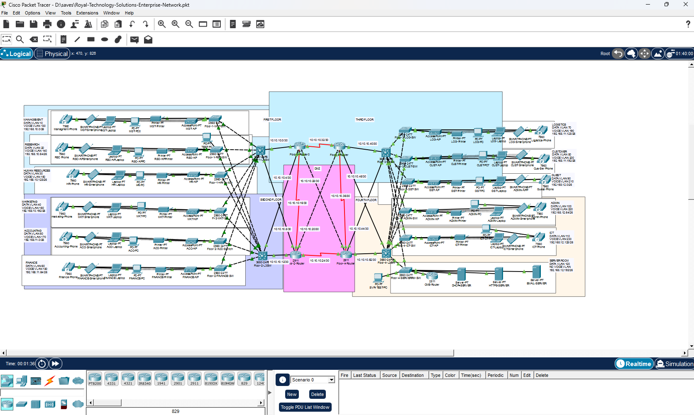

# Design 2 — Enterprise Campus

**Role in portfolio:** The second standalone design, later integrated with Royal campus and branch.

Original owner-provided screenshot of `Royal-Technology-Solutions-Enterprise-Network.pkt`, showing the standalone four-floor Enterprise design, core/distribution links, departmental data and voice networks, and server room. This predates the integrated Enterprise perimeter firewall/edge-router addition.

## Design scope

A four-floor network uses an OSPF core, multilayer distribution switches, departmental access switches, and HSRP virtual gateways. Enterprise data networks occupy /26 subnets within 192.168.10.0/24 through 192.168.12.0/24. Voice networks occupy /26 subnets within 192.168.13.0/24 through 192.168.15.0/24.

Departments include Management, Research, HR, Marketing, Accounting, Finance, Logistics, Customer, Guest, Admin, and ICT, plus the server room. VLANs separate data and voice, while existing access policies provide departmental restrictions. Specific floor placement should follow the actual original drawing, not assumptions from switch names.

## Services carried into integration

| Service | Address / identifier |
|---|---|
| DHCP/DNS | 192.168.12.196 |
| HTTPS | 192.168.12.198 |
| Enterprise CME | 192.168.12.202; extensions 2101–2111 |
| Server-room virtual gateway | 192.168.12.193/26 |

## Integration change

The original Enterprise network was connected to the simulated cloud/provider segment. The final upgrade added ENTERPRISE-FW01 and ENTERPRISE-EDGE-RTR without moving the established core-to-floor Ethernet links. Mail was consolidated to the shared cloud-segment server rather than retaining a separate Enterprise mail path.

## Original artifacts

The standalone topology screenshot is included above. The corresponding final `.pkt` binary still needs to be attached; the supplied `.pkt.png` file is an image, not an executable Packet Tracer project. Existing older files are not substituted for this final original.

[Back to portfolio](../../README.md)
