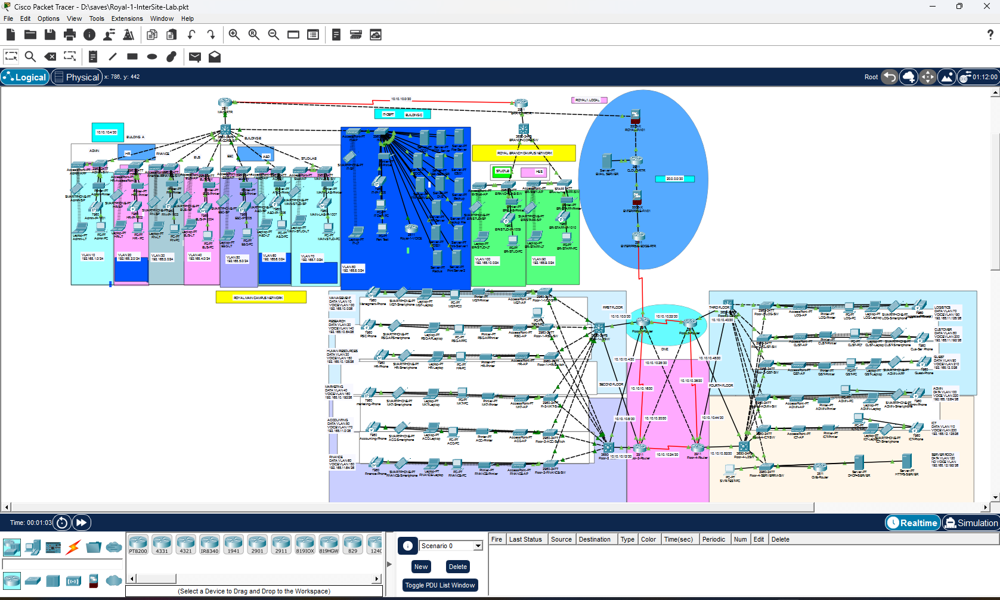

# Design 3 — Royal1 Intersite-Lab

**Status:** Complete, owner-confirmed October 29, 2026.

## Integration outcome

Two independently completed network designs were joined into one multi-site Packet Tracer lab supporting cross-site IP connectivity, HTTPS in both directions, shared mail with confirmed replies, and intersite phone calls.

## New devices

| Device | Purpose |
|---|---|
| ENTERPRISE-FW01 — ASA 5506-X | Enterprise perimeter filtering between provider/cloud segment and Enterprise edge |
| ENTERPRISE-EDGE-RTR — Cisco 2911 with serial module | Ethernet connection to ASA; serial connection to existing Enterprise core |

## Transit connections

| Endpoint A | Endpoint B | Subnet |
|---|---|---|
| CLOUD-RTR Gi0/2 — 172.31.255.5 | ASA Gi1/2 outside — 172.31.255.6 | 172.31.255.4/30 |
| ASA Gi1/1 inside — 172.31.255.9 | EDGE Gi0/0 — 172.31.255.10 | 172.31.255.8/30 |
| EDGE S0/0/0 — 172.31.255.13 | Core-L3-R1 S0/3/1 — 172.31.255.14 | 172.31.255.12/30 |

R1 is the recorded serial DCE end. Its original S0/3/0 and CLOUD-RTR S0/1/1 remain shut down. The temporary fiber and transit-VLAN approaches were abandoned.

## Route flow

CLOUD-RTR sends Enterprise /24 summaries to ASA outside at .6 using distance 10. ASA sends Enterprise routes inside to EDGE at .10 and defaults outside to CLOUD-RTR at .5. EDGE sends the six Enterprise /24 summaries to core at .14 and defaults to ASA inside at .9. R1 sends Royal and mail destinations to EDGE at .13, redistributes static routes into OSPF, and advertises the new serial transit /30 with its interface passive.

## Validation and limits

Final owner confirmation covers working websites, mail, calls, and all-PC ping. Detailed session evidence includes endpoint pings, successful page loads in both directions, delivered mail and reply, and successful calling. HTTPS return ACL entries explicitly target Campus Admin 192.168.1.2 and Enterprise SVR-TEST 192.168.12.197. Success from those PCs does not demonstrate web access from every endpoint.

[Full routes, ACLs, and troubleshooting history](../../docs/architecture-and-operational-record.md)

[Back to portfolio](../../README.md)
