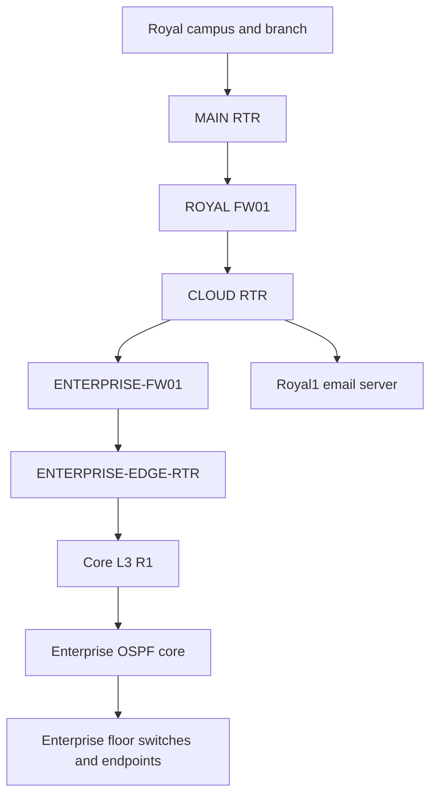

# Royal Technology Solutions Network Project

## Architecture and operational record

**Project owner:** LaVon Thomas  
**Record date:** October 29, 2026  
**Release:** Completed Intersite-Lab — Enterprise perimeter firewall upgrade  
**Scope:** Combined Packet Tracer campus and Enterprise design, focused on the Packet Tracer environment; real Windows labs are separate.  
**Evidence:** Configuration excerpts, test outputs and owner reports in the project conversation. This is a point-in-time reconstruction, not an export of the current project file.

## Project purpose and status

The project connects the Royal campus and branch simulation with a separate Enterprise campus simulation. The combined Packet Tracer file demonstrates routing, segmentation, gateway redundancy, firewall rules, DHCP, DNS, phone registration and cross-site calling, and a consolidated email service. The Windows home lab is a separate environment with its own servers and backup infrastructure.

**Current status — COMPLETE, owner-confirmed October 29, 2026.** LaVon Thomas confirmed end-to-end website access, email, phone calls, and the ability of all PCs to ping one another after adding the Enterprise firewall and edge router. This is the final functional completion checkpoint for the combined Packet Tracer design. Earlier transient failures are troubleshooting history, not current unresolved faults.

**Evidence:** The session contains configuration outputs, successful bidirectional ping tests, HTTPS success in each direction, email delivery and reply confirmation, and a successful cross-site call. Final all-PC coverage and overall completion are owner-confirmed; a full per-endpoint matrix and final `.pkt` export were not supplied.

The project models the network foundation for intersite collaboration. Teams and Microsoft 365 were analogies for the goal; those products were not deployed or validated in Packet Tracer. The WAN is a simulated routed connection, with no demonstrated IPsec tunnel, AD trust, or connection to the separate real Windows labs.

## Combined topology



The branch connects to MAIN-RTR over a separate serial link. CLOUD-RTR Gi0/0 connects directly to the consolidated Royal1.com mail server at the latest reported checkpoint. A temporary cloud switch and second mail server were tried and then removed from the active path; verify the remaining devices in the saved file before removing anything.

### Inter-site link

| Device | Interface | Address | Role |
|---|---|---|---|
| CLOUD-RTR | Serial0/1/1 | 172.31.255.1/30 | Old direct path; administratively shut down |
| Core-L3-R1 | Serial0/3/0 | 172.31.255.2/30 | Old direct path; administratively shut down |
| CLOUD-RTR | Gi0/2 | 172.31.255.5/30 | To Enterprise firewall outside |
| ENTERPRISE-FW01 | Gi1/2 outside | 172.31.255.6/30 | To CLOUD-RTR Gi0/2 |
| ENTERPRISE-FW01 | Gi1/1 inside | 172.31.255.9/30 | To Enterprise edge router |
| ENTERPRISE-EDGE-RTR | Gi0/0 | 172.31.255.10/30 | To firewall inside |
| ENTERPRISE-EDGE-RTR | Serial0/0/0 | 172.31.255.13/30 | To Enterprise core; DTE |
| Core-L3-R1 | Serial0/3/1 | 172.31.255.14/30 | To edge router; DCE, clock rate 2000000 |
| CLOUD-RTR | Gi0/1 | 10.10.20.5/30 | To firewall outside |
| ROYAL-FW01 | Gi1/2 outside | 10.10.20.6/30 | Firewall outside |
| ROYAL-FW01 | Gi1/1 inside | 10.10.20.2/30 | Firewall inside |
| MAIN-RTR | Gi0/1 | 10.10.20.1/30 | To firewall inside |
| MAIN-RTR | Serial0/1/1 | 10.10.10.1/30 | Main to branch |
| BRANCH-RTR | Serial0/2/0 | 10.10.10.2/30 | Branch to main |

The active intersite path crosses both site firewalls. ENTERPRISE-FW01 is an ASA 5506-X simulation; ENTERPRISE-EDGE-RTR is an added Cisco 2911 with an HWIC-2T serial module. Ethernet links connect CLOUD-RTR to the ASA and the ASA to the edge router; a serial link connects the edge router to R1. Existing floor uplinks were preserved. The trial fiber/switchport/VLAN998–999 approaches were abandoned and are not part of the final path.

The original cloud-to-core cable was retained for rollback with both interfaces shut down. Its distance-1 routes remain configured but inactive while that link is down. The new distance-10 routes are active. Re-enabling the old link would prefer a path bypassing the Enterprise firewall; it is not a security-equivalent automatic backup.

The copied designs reused portions of 10.10.10.0 space for internal transit. Keep these separate and avoid advertising conflicting transit networks across the simulated WAN. The branch student network was changed from 192.168.10.0/24 to **192.168.210.0/24** because it overlapped Enterprise addresses. VLAN 100 remained the student VLAN; its gateway and DHCP scope were updated.

## Royal campus and branch addressing

| Network or function | Subnet | Gateway or endpoint |
|---|---|---|
| Campus Admin | 192.168.1.0/24 | 192.168.1.1 |
| Campus HR | 192.168.2.0/24 | 192.168.2.1 |
| Campus Finance | 192.168.3.0/24 | 192.168.3.1 |
| Campus Business | 192.168.4.0/24 | 192.168.4.1 |
| Campus E and C | 192.168.5.0/24 | 192.168.5.1 |
| Campus A and D | 192.168.6.0/24 | 192.168.6.1 |
| Campus student lab | 192.168.7.0/24 | 192.168.7.1 |
| Campus IT and servers | 192.168.8.0/24 | 192.168.8.1 |
| Branch staff | 192.168.9.0/24 | 192.168.9.1 |
| Branch student lab | 192.168.210.0/24 | 192.168.210.1 |
| Campus voice VLAN 110 | 192.168.110.0/24 | 192.168.110.1 |
| Branch voice VLAN 120 | 192.168.120.0/24 | 192.168.120.1 |
| Campus DNS | 192.168.8.17 | DNS service |
| Campus HTTPS | 192.168.8.18 | Royal web server |
| VOICE01 | 192.168.8.22 | Call control and phone configuration |
| Cloud segment | 20.0.0.0/24 | CLOUD-RTR 20.0.0.1; Royal1 mail 20.0.0.2 |

MAIN-RTR provides router-on-a-stick interfaces and DHCP scopes for campus networks. BRANCH-RTR provides staff, student and branch voice scopes. Voice DHCP option 150 points to VOICE01 at 192.168.8.22. RIP version 2 is used between the campus and branch routers. Verify current scope contents and route distribution after reopening the project.

## Enterprise VLAN plan

Each data and voice network below uses a /26 mask, 255.255.255.192. The gateway listed is the HSRP virtual address. The Enterprise data and voice VLAN numbers are local to this topology; similar VLAN numbers in the other topology do not imply a shared Layer 2 domain.

| Function | Data VLAN | Data network / gateway | Voice VLAN | Voice network / gateway | Extension |
|---|---:|---|---:|---|---:|
| Management | 10 | 192.168.10.0/26 / .10.1 | 130 | 192.168.13.0/26 / .13.1 | 2101 |
| Research | 20 | 192.168.10.64/26 / .10.65 | 140 | 192.168.13.64/26 / .13.65 | 2102 |
| HR | 30 | 192.168.10.128/26 / .10.129 | 150 | 192.168.13.128/26 / .13.129 | 2103 |
| Marketing | 40 | 192.168.10.192/26 / .10.193 | 160 | 192.168.13.192/26 / .13.193 | 2104 |
| Accounting | 50 | 192.168.11.0/26 / .11.1 | 170 | 192.168.14.0/26 / .14.1 | 2105 |
| Finance | 60 | 192.168.11.64/26 / .11.65 | 180 | 192.168.14.64/26 / .14.65 | 2106 |
| Logistics | 70 | 192.168.11.128/26 / .11.129 | 190 | 192.168.14.128/26 / .14.129 | 2107 |
| Customer | 80 | 192.168.11.192/26 / .11.193 | 200 | 192.168.14.192/26 / .14.193 | 2108 |
| Guest | 90 | 192.168.12.0/26 / .12.1 | 210 | 192.168.15.0/26 / .15.1 | 2109 |
| Admin | 100 | 192.168.12.64/26 / .12.65 | 220 | 192.168.15.64/26 / .15.65 | 2110 |
| ICT | 110 | 192.168.12.128/26 / .12.129 | 230 | 192.168.15.128/26 / .15.129 | 2111 |
| Server room | 120 | 192.168.12.192/26 / .12.193 | — | — | — |

Gateway abbreviations such as `.10.1` mean `192.168.10.1`. Names follow the reported switch and VLAN mapping; verify floor assignments against the original design before producing a formal floor plan.

Enterprise DHCP/DNS is at **192.168.12.196**. Voice DHCP pools supply the appropriate subnet gateway and TFTP address **192.168.12.202**. For VLAN 150 the observed pool started at 192.168.13.134, gateway 192.168.13.129, and mask /26. A maximum of 58 addresses would include broadcast .191; the recommended maximum was corrected to 57, but the saved server setting needs verification. Audit other pool endpoints and reserved addresses as a separate task.

## Enterprise core and switching

| Device | Routed links recorded |
|---|---|
| Core-L3-R1 | Gi0/0 10.10.10.29; Gi0/1 .2; Gi0/2 .6; S0/2/0 .33; S0/2/1 .17; active edge S0/3/1 172.31.255.14; old S0/3/0 172.31.255.2 shut down |
| Core-L3-R2 | Gi0/0 10.10.10.21; Gi0/1 .10; Gi0/2 .14; S0/2/0 .18; S0/2/1 .25 |
| Core-L3-R3 | Gi0/0 10.10.10.22; Gi0/1 .42; Gi0/2 .50; S0/2/0 .34; S0/2/1 .38 |
| Core-L3-R4 | Gi0/0 10.10.10.30; Gi0/1 .46; Gi0/2 .54; S0/2/0 .26; S0/2/1 .37 |
| F1-L3-SW | Routed Gi1/0/1 10.10.10.1; Gi1/0/2 10.10.10.9 |
| F2-L3-SW | Routed Gi1/0/1 10.10.10.5; Gi1/0/2 10.10.10.13 |
| F3-L3-SW | Routed Gi1/0/1 10.10.10.41; Gi1/0/2 10.10.10.45 |
| F4-L3-SW | Routed Gi1/0/1 10.10.10.49; Gi1/0/2 10.10.10.53 |

Addresses abbreviated with a leading dot in this table use the 10.10.10.x prefix; observed routed links use /30 masks. After a Packet Tracer restart, the core-facing OSPF adjacencies in the captured output were FULL, including the previously missing F3–R3 .41/.42 adjacency. A FULL state is a snapshot rather than proof of sustained stability. Core-L3-R1 appeared with OSPF router ID 172.31.255.2 after restart; confirm the current router ID before troubleshooting.

F1 and F3 L3 switches were configured as preferred HSRP gateways with priority 110; their F2 and F4 peers used priority 100. Observed state changes included temporary disagreement about active roles. Some voice SVIs have active OSPF adjacencies between L3 switches and were used as return paths in one routing snapshot. Review the intended design and redundancy before altering OSPF or HSRP.

Enterprise access switches use designated ports consistently: Fa0/4 is the usual phone/PC chain, Fa0/3 is another access endpoint and Fa0/5 a separate endpoint. Do not change port assignments without checking the topology. Port-security sticky MAC entries from the copied project caused several ports to become err-disabled; per-port removal of stale entries and shutdown/no shutdown restored service while retaining security. Identify current MACs before modifying a port.

## Firewall and site routing — final recorded configuration

These are configuration reference excerpts from the working session, not commands requiring re-entry. No NAT was configured on the new Enterprise firewall. Both ASAs use inside security level 100, outside level 0, and an `OUTSIDE-IN` ACL applied inbound on outside.

### CLOUD-RTR active Enterprise routes

```text
ip route 192.168.10.0 255.255.255.0 172.31.255.6 10
ip route 192.168.11.0 255.255.255.0 172.31.255.6 10
ip route 192.168.12.0 255.255.255.0 172.31.255.6 10
ip route 192.168.13.0 255.255.255.0 172.31.255.6 10
ip route 192.168.14.0 255.255.255.0 172.31.255.6 10
ip route 192.168.15.0 255.255.255.0 172.31.255.6 10
```

Royal routes remain via ROYAL-FW01 at 10.10.20.6, including the 192.168.0.0/16 summary. CLOUD-RTR Gi0/0 remains 20.0.0.1/24 for the consolidated mail server 20.0.0.2.

### ENTERPRISE-EDGE-RTR routes

```text
ip route 192.168.10.0 255.255.255.0 172.31.255.14
ip route 192.168.11.0 255.255.255.0 172.31.255.14
ip route 192.168.12.0 255.255.255.0 172.31.255.14
ip route 192.168.13.0 255.255.255.0 172.31.255.14
ip route 192.168.14.0 255.255.255.0 172.31.255.14
ip route 192.168.15.0 255.255.255.0 172.31.255.14
ip route 0.0.0.0 0.0.0.0 172.31.255.9
```

### Core-L3-R1 active external routes and OSPF

```text
ip route 192.168.1.0 255.255.255.0 172.31.255.13 10
ip route 192.168.2.0 255.255.255.0 172.31.255.13 10
ip route 192.168.3.0 255.255.255.0 172.31.255.13 10
ip route 192.168.4.0 255.255.255.0 172.31.255.13 10
ip route 192.168.5.0 255.255.255.0 172.31.255.13 10
ip route 192.168.6.0 255.255.255.0 172.31.255.13 10
ip route 192.168.7.0 255.255.255.0 172.31.255.13 10
ip route 192.168.8.0 255.255.255.0 172.31.255.13 10
ip route 192.168.9.0 255.255.255.0 172.31.255.13 10
ip route 192.168.110.0 255.255.255.0 172.31.255.13 10
ip route 192.168.120.0 255.255.255.0 172.31.255.13 10
ip route 192.168.210.0 255.255.255.0 172.31.255.13 10
ip route 20.0.0.0 255.255.255.252 172.31.255.13 10
ip route 20.0.0.4 255.255.255.255 172.31.255.13 10
```

```text
router ospf 10
 log-adjacency-changes
 redistribute static subnets
 passive-interface Serial0/3/1
 network 10.10.10.0 0.0.0.3 area 0
 network 10.10.10.4 0.0.0.3 area 0
 network 10.10.10.16 0.0.0.3 area 0
 network 10.10.10.28 0.0.0.3 area 0
 network 10.10.10.32 0.0.0.3 area 0
 network 172.31.255.12 0.0.0.3 area 0
```

Advertising 172.31.255.12/30 gives internal Enterprise devices a return route to the edge serial addresses. The passive interface advertises the subnet without forming an OSPF adjacency to EDGE-RTR. The 20.0.0.4 host route is retained legacy configuration for the disconnected second mail server; the active mail server is .2. The recorded mail route remains /30 even though the cloud Ethernet segment is /24.

### ENTERPRISE-FW01 routes

```text
route inside 192.168.10.0 255.255.255.0 172.31.255.10 1
route inside 192.168.11.0 255.255.255.0 172.31.255.10 1
route inside 192.168.12.0 255.255.255.0 172.31.255.10 1
route inside 192.168.13.0 255.255.255.0 172.31.255.10 1
route inside 192.168.14.0 255.255.255.0 172.31.255.10 1
route inside 192.168.15.0 255.255.255.0 172.31.255.10 1
route inside 172.31.255.12 255.255.255.252 172.31.255.10 1
route outside 0.0.0.0 0.0.0.0 172.31.255.5 1
```

### ENTERPRISE-FW01 outside policy

```text
access-list OUTSIDE-IN extended permit icmp 192.168.0.0 255.255.0.0 192.168.10.0 255.255.255.0
access-list OUTSIDE-IN extended permit icmp 192.168.0.0 255.255.0.0 192.168.11.0 255.255.255.0
access-list OUTSIDE-IN extended permit icmp 192.168.0.0 255.255.0.0 192.168.12.0 255.255.255.0
access-list OUTSIDE-IN extended permit icmp 192.168.0.0 255.255.0.0 192.168.13.0 255.255.255.0
access-list OUTSIDE-IN extended permit icmp 192.168.0.0 255.255.0.0 192.168.14.0 255.255.255.0
access-list OUTSIDE-IN extended permit icmp 192.168.0.0 255.255.0.0 192.168.15.0 255.255.255.0
access-list OUTSIDE-IN extended permit udp 192.168.0.0 255.255.0.0 host 192.168.12.196 eq 53
access-list OUTSIDE-IN extended permit tcp 192.168.0.0 255.255.0.0 host 192.168.12.196 eq 53
access-list OUTSIDE-IN extended permit tcp 192.168.0.0 255.255.0.0 host 192.168.12.198 eq 443
access-list OUTSIDE-IN extended permit tcp host 192.168.8.22 host 192.168.12.202 eq 1720
access-list OUTSIDE-IN extended permit tcp host 192.168.8.18 eq 443 host 192.168.12.197
access-group OUTSIDE-IN in interface outside
```

### ROYAL-FW01 routes and outside policy

```text
route inside 192.168.0.0 255.255.0.0 10.10.20.1 1
route outside 20.0.0.0 255.255.255.252 10.10.20.5 1
route outside 192.168.10.0 255.255.255.0 10.10.20.5 1
route outside 192.168.11.0 255.255.255.0 10.10.20.5 1
route outside 192.168.12.0 255.255.255.0 10.10.20.5 1
route outside 192.168.13.0 255.255.255.0 10.10.20.5 1
route outside 192.168.14.0 255.255.255.0 10.10.20.5 1
route outside 192.168.15.0 255.255.255.0 10.10.20.5 1
route outside 20.0.0.4 255.255.255.255 10.10.20.5 1
```

```text
access-list OUTSIDE-IN extended permit icmp 192.168.11.64 255.255.255.192 host 192.168.8.22
access-list OUTSIDE-IN extended permit tcp host 192.168.12.202 host 192.168.8.22
access-list OUTSIDE-IN extended permit icmp 192.168.10.0 255.255.255.0 192.168.0.0 255.255.0.0
access-list OUTSIDE-IN extended permit icmp 192.168.11.0 255.255.255.0 192.168.0.0 255.255.0.0
access-list OUTSIDE-IN extended permit icmp 192.168.12.0 255.255.255.0 192.168.0.0 255.255.0.0
access-list OUTSIDE-IN extended permit icmp 192.168.13.0 255.255.255.0 192.168.0.0 255.255.0.0
access-list OUTSIDE-IN extended permit icmp 192.168.14.0 255.255.255.0 192.168.0.0 255.255.0.0
access-list OUTSIDE-IN extended permit icmp 192.168.15.0 255.255.255.0 192.168.0.0 255.255.0.0
access-list OUTSIDE-IN extended permit tcp host 192.168.12.198 eq 443 host 192.168.1.2
access-list OUTSIDE-IN extended permit tcp 192.168.10.0 255.255.254.0 host 192.168.8.18 eq 443
access-list OUTSIDE-IN extended permit tcp 192.168.12.0 255.255.255.0 host 192.168.8.18 eq 443
access-group OUTSIDE-IN in interface outside
```

The separate recorded `ICMP-INSPECT` ACL permits Royal 192.168.0.0/16 to 20.0.0.0/30; it was not the outside interface ACL.

### Inspection and HTTPS scope

```text
policy-map global_policy
 class inspection_default
  inspect dns preset_dns_map
  inspect ftp
  inspect h323
  inspect icmp
  inspect tftp
service-policy global_policy global
```

ENTERPRISE-FW01 output confirmed the inspection policy above; H.323 inspection was also instructed on ROYAL-FW01 before call success, although its final policy output was not supplied. Packet Tracer accepted `inspect h323`, not `inspect h323 h225`.

Explicit TCP source-port-443 return rules were added after observed simulation drops. These allow replies specifically to Campus Admin 192.168.1.2 and Enterprise SVR-TEST 192.168.12.197. They do not establish HTTPS coverage for every PC and do not constitute TCP state validation. Normal stateful ASA return behavior should not be inferred from these simulator workarounds. All-PC ping coverage is separately owner-confirmed.

## Voice services and extension plan

| Call manager | Address | Extensions | Observed role |
|---|---|---|---|
| Enterprise CME-ROUTER | 192.168.12.202/26, gateway 192.168.12.193 | 2101–2111 | Eleven ephones and directory numbers |
| Campus VOICE01 | 192.168.8.22/24, gateway 192.168.8.1 | 1001–1010 | Ten ephones, including branch phones |

Enterprise ephone MAC addresses were updated after copying the topology. At one checkpoint all eleven ephones were REGISTERED and IDLE. Management 2101 and HR 2103 connected locally. Calls **1003 → 2103 and 2103 → 1003** were reported successful. A branch phone cross-site call and all extension pairs were not separately documented. Some active-call output showed zero media packet counters, so independent audio/media validation is still recommended.

The configured VoIP dial peers were:

```text
VOICE01:    destination-pattern 21..  → 192.168.12.202
CME-ROUTER: destination-pattern 10..  → 192.168.8.22
```

Finance phone 2106 was previously DECEASED, then appeared REGISTERED after a restart. Phone registration and extension displays were intermittent before the restart. Branch Student 1009 and Staff 1010 were reported registered on VOICE01. A registered state confirms call-manager registration, not all call paths or audio.

## Email design and tests

The final reported direction consolidates mail to **Royal1.com** on **20.0.0.2**, directly connected to CLOUD-RTR Gi0/0. The owner reported email working site to site after setting client incoming and outgoing servers to 20.0.0.2 and configuring accounts. A local L.Thomas self-send/receive test was reported successful. The exact final sender/recipient pair and test evidence for every PC were not captured.

The former Enterprise Royalty.com mail server was originally 192.168.12.201, temporarily moved to 20.0.0.4, and subsequently disconnected from the active path. It may still contain accounts or mail; do not delete it until the owner confirms anything needed has been retained. Review clients, DHCP/DNS records, and routes for stale 192.168.12.201 or 20.0.0.4 references. DNS at 192.168.12.196 was turned on during testing; actual records and service status need verification. The campus DNS server is 192.168.8.17.

Earlier SMTP/POP3 authentication failures involved mismatched server settings and account credentials. A delivery failure addressed to `adminRoyalty.com` was malformed; the failure notice included the original message body and did not prove recipient delivery. Do not include account passwords in documentation. Packet Tracer mail functionality and inter-server behavior were not separately validated; use the consolidated design as the current checkpoint.

## Final validation and completion — October 29, 2026

**Result: COMPLETE — owner-confirmed end-to-end operation after the Enterprise firewall upgrade.**

| Validation | Final result / evidence |
|---|---|
| Campus Admin → Enterprise DNS 192.168.12.196 | Captured 4/4 ping replies |
| Campus Admin → Enterprise HTTPS server 192.168.12.198 | Captured 4/4 ping replies; page success reported |
| Enterprise SVR-TEST → Royal HTTPS 192.168.8.18 | Captured successful pings; page success reported |
| Cross-site HTTPS in both directions | Final owner confirmation after outside-link recovery |
| Email between sites, including reply delivery | Owner confirmed sent and received |
| Cross-site phone calls | Successful call reported; final owner confirmation of phone service |
| All-PC intersite and end-to-end ping | Owner confirmed all PCs can ping each other |
| Enterprise perimeter path | New ASA and 2911 edge router active; old direct serial path administratively shut down |

The final report supersedes earlier intermittent failures. No ongoing outage is reported. A full final configuration export, per-extension call matrix, all-client HTTPS coverage, and save/reopen test were not supplied; these are evidence boundaries, not a new requirement to repeat completed work. Separate Windows Royal1.Local monitoring/login tasks remain outside this Packet Tracer completion.

## Troubleshooting history and recovery observations

- The new serial link temporarily became up/down at both ends despite matching HDLC encapsulation and keepalives. DCE was confirmed on R1 S0/3/1 with clock rate 2000000; EDGE S0/0/0 was DTE. A shutdown/no shutdown of the new link restored up/up. No root cause was established.
- Enterprise transit 172.31.255.12/30 was initially absent from internal OSPF advertisements. Adding its network statement and marking the serial interface passive restored the tested return path.
- HTTPS drops observed at each ASA led to the explicitly scoped return rules documented above. Ping success alone did not prove TCP/HTTPS success.
- Before final recovery, ENTERPRISE-FW01 had its default route configured but lacked an ARP entry for CLOUD-RTR 172.31.255.5. Packet Tracer offered no supported ARP-clear command. Cycling only Gi1/2 restored an ARP entry for .5; the owner subsequently confirmed all services working end to end. This establishes the observed recovery sequence, not a proven simulator or protocol root cause.
- Phone-call timing coincided with failures during troubleshooting, but no evidence established that calls caused them.


- A red X in Packet Tracer on one copy of an ARP broadcast can be normal for a device that does not own the target IP. Examine the event's device, protocol, VLAN, and OSI explanation.
- `up/up` on a physical interface does not prove HSRP gateway reachability, DHCP, or application delivery. CME reached F3's physical .194 while .193 failed at one point; later .193 recovered.
- Port security identified stale sticky MACs on copied Enterprise switch ports. CME router MAC 00E0.8F7D.AC7A was learned on F4-SERVERRM-SW Fa0/6; retain the port limit and validate the attached device before replacing entries.
- F4-SERVERRM-SW Fa0/2 was temporarily shut during troubleshooting and later restored. Confirm it is connected and forwarding as intended. A 5/5 gateway ping after the test did not prove the link was the root cause.
- `show ip route` and `show ip ospf neighbor` are useful to distinguish missing routes from application problems. New OSPF external routes required time to propagate in the simulation.
- Email client SMTP and POP3 settings should point to the correct server for the configured account. A send success alone does not prove recipient delivery; confirm the intended recipient inbox and the exact message.

## Separate environments

Royal1.Local Windows and Royalty.Local/AWS are separate projects. Their domain, host storage, and backup details are outside this networking portfolio.

## Operational handoff

1. Keep an untouched copy of each original Packet Tracer project and a dated copy of the combined file.
2. On each modified Cisco device, save the intended running configuration with `write memory` or `copy running-config startup-config`, then save the combined `.pkt` file. Confirm the ASA and server GUI changes are retained after reopening.
3. Record a current IP plan, DHCP pool settings, DNS records, firewall ACLs, email users, and phone-to-extension inventory from the saved file. Store secrets separately in a password manager; this record intentionally contains no passwords.
4. Treat the October 29, 2026 owner-confirmed final validation as the current known-good baseline. Retain available test evidence with the project. Repeat targeted validation when a configuration change, new deployment or observed fault warrants it.
5. If instability recurs, record HSRP roles, STP root and forwarding state, OSPF neighbors and route changes at the same time before making topology changes.

## Portfolio wording

Completed and integrated two Packet Tracer network designs into a unified multi-site environment. Added an Enterprise ASA 5506-X perimeter firewall and Cisco 2911 edge router while preserving existing campus uplinks. Implemented routed transit networks, OSPF route distribution, site firewall policies, and validated end-to-end web access, email with replies, cross-site phone calls, and owner-confirmed all-PC reachability.

Designed and tested a multi-site network simulation combining segmented campus and branch networks with an Enterprise OSPF core. Configured VLANs, redundant gateways, dynamic and static routing, firewall policies, DHCP/DNS, Cisco call-manager services, cross-site calling, and a shared email service. Troubleshot address overlap, stale port-security entries, route propagation, intermittent gateway reachability, and service configuration. Completed a network reset and validation cycle; the project owner confirmed stable operation and that all settings and configurations passed.

**Evidence boundaries:** The environment is a Packet Tracer simulation. Cross-site calls and email were reported successful, and the owner subsequently confirmed stable operation after reset and validation. Final October 29 confirmation covers end-to-end website, email, phone, and all-PC ping operation; a detailed per-endpoint matrix was not supplied. This description does not claim a production deployment, encrypted VPN, or Active Directory trust.
